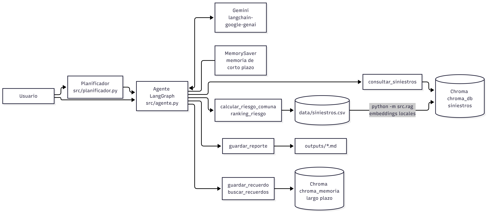
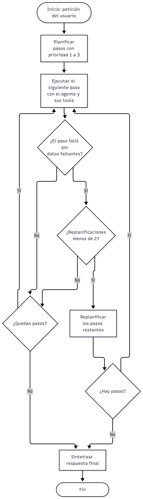
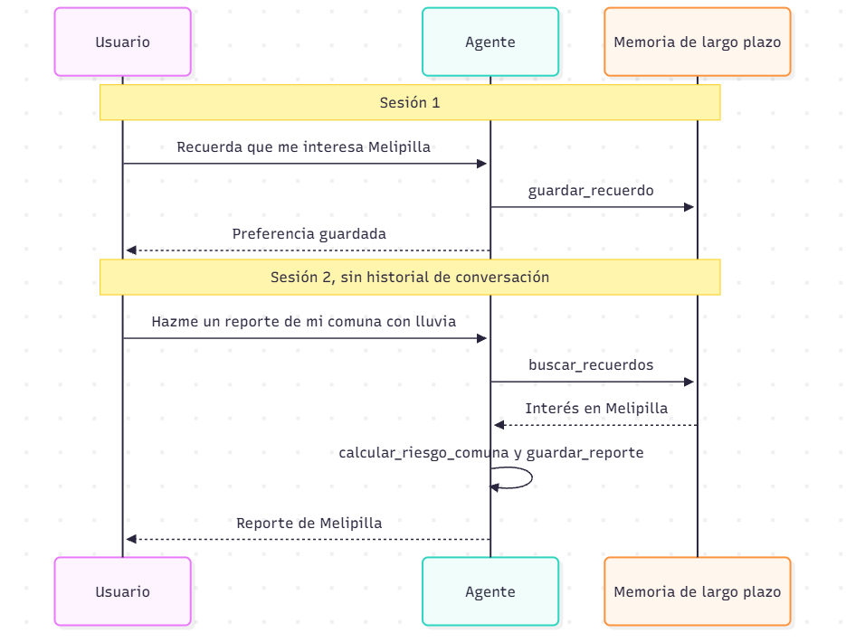

# Agente de riesgo vial en Chile (LLM + RAG + agente)

Evaluación Parcial 2 de Ingeniería de Soluciones con IA (ISY0101): agente funcional que consulta datos de siniestros viales, calcula un puntaje de riesgo por comuna, genera reportes y planifica tareas con replanificación ante datos faltantes. Es la continuación del caso de la Evaluación Parcial 1.

Autoría: Lucia Salazar - Alexis Armijo
> **Nota sobre los datos:** `data/siniestros.csv` es un conjunto **simulado** (800 siniestros generados con `src/generar_datos.py`) con la estructura de las estadísticas de CONASET. Se optó por datos simulados para poder controlar los escenarios de prueba del agente. El sistema no depende de ellos: cualquier CSV con las mismas columnas se puede usar ejecutando `python -m src.rag`.

## Qué hace

- **Consulta (RAG):** busca siniestros por significado en una base vectorial (Chroma) con embeddings locales.
- **Razonamiento:** calcula un puntaje de riesgo de 0 a 100 por comuna, con filtro opcional por clima. Fórmula: `10 × fallecidos + 3 × lesionados graves + 1 × siniestros`, escalada contra la comuna más riesgosa.
- **Escritura:** guarda reportes en Markdown en `outputs/`.
- **Memoria de corto plazo:** checkpointer de LangGraph (conversación de una sesión).
- **Memoria de largo plazo:** vector store persistente (`chroma_memoria/`) con preferencias e intereses del usuario, que se recuperan en otras sesiones.
- **Planificador:** descompone la petición en pasos con prioridades, los ejecuta y replanifica (máximo 2 veces) cuando un paso falla por datos faltantes.

## Tecnologías

Python 3.12, LangChain, LangGraph, Gemini (`langchain-google-genai`), sentence-transformers (modelo multilingüe `paraphrase-multilingual-MiniLM-L12-v2`, local), Chroma, pandas.

## Estructura del repositorio

```
src/
  generar_datos.py      genera data/siniestros.csv (datos simulados)
  rag.py                ingesta: CSV -> chunks -> embeddings locales -> Chroma
  agente.py             agente LangGraph con 6 herramientas y memoria
  planificador.py       plan-and-execute con prioridades y replanificación
  tools/
    consulta.py         consultar_siniestros (RAG)
    riesgo.py           calcular_riesgo_comuna, ranking_riesgo
    reporte.py          guardar_reporte (Markdown en outputs/)
  memory/
    largo_plazo.py      guardar_recuerdo, buscar_recuerdos
data/                   siniestros.csv
tests/evidencia/        salidas de los 3 escenarios de prueba
outputs/                reportes generados por el agente
docs/                   diagramas y bocetos de diseño
```

## Cómo ejecutarlo (Windows, PowerShell)

1. Clonar el repositorio y entrar a la carpeta:

```powershell
git clone https://github.com/kodevlyu/agente-riesgo-vial.git
cd agente-riesgo-vial
```

2. Crear y activar el entorno virtual (requiere Python 3.12) e instalar dependencias:

```powershell
py -3.12 -m venv .venv
.\.venv\Scripts\Activate.ps1
pip install -r requirements.txt
```

Si PowerShell bloquea el script de activación, ejecutar antes `Set-ExecutionPolicy -Scope Process -ExecutionPolicy RemoteSigned`.

3. Configurar la llave de Gemini. Copiar la plantilla a `.env` y editarla (la llave se obtiene gratis en Google AI Studio):

```powershell
Copy-Item .env.example .env
```

El archivo `.env` debe quedar con estas dos variables (sin comillas):

```
GOOGLE_API_KEY=tu_llave
GEMINI_MODEL=gemini-3.5-flash-lite
```

El `.env` no se sube al repositorio. La cuota gratuita de Gemini es limitada por día y por modelo; si aparece un error 429, cambiar `GEMINI_MODEL` por otro modelo Flash disponible en la cuenta.

4. Construir el índice de siniestros (la primera vez descarga el modelo de embeddings, unos 470 MB):

```powershell
python -m src.rag
```

El archivo `data/siniestros.csv` ya viene en el repositorio. Para regenerarlo: `python src/generar_datos.py`.

5. Usar el agente (pregunta y nombre de sesión opcional):

```powershell
python -m src.agente "¿Cuántos siniestros hubo en Maipú y cuál fue la causa más frecuente?" sesion-1
```

6. Usar el planificador (tareas de varios pasos, con reporte y replanificación):

```powershell
python -m src.planificador "Compara las 3 comunas más riesgosas con lluvia y sin lluvia, y guarda un reporte con la comparación."
```

7. Para partir con la memoria de largo plazo vacía:

```powershell
Remove-Item chroma_memoria -Recurse -ErrorAction SilentlyContinue
```

## Diagramas y bocetos de diseño

Los diagramas del sistema están en `docs/` (código fuente en `docs/diagramas.md`).

**Arquitectura general**



**Flujo del planificador con replanificación**



**Memoria de corto y largo plazo**



## Pruebas y evidencia

Los tres escenarios de prueba están en `tests/evidencia/`:

| Escenario | Qué demuestra | Archivo |
|---|---|---|
| 1. Consulta simple | RAG con una herramienta | `escenario1-consulta-simple.txt` |
| 2. Tarea multietapa con reporte | Plan con prioridades y herramienta de escritura | `escenario2-multietapa.txt` |
| 3a. Condición cambiante (comuna sin datos) | Fallo de un paso y replanificación | `escenario3a-replanificacion.txt` |
| 3b. Recuerdo entre sesiones | Memoria de largo plazo | `escenario3b-sesion1.txt`, `escenario3b-sesion2.txt` |

Los reportes que generó el agente en esas pruebas están en `outputs/`.

## Limitaciones conocidas

- Los datos son simulados.
- El puntaje se escala contra la comuna más riesgosa de cada filtro, por lo que puntajes con y sin filtro de clima no son estrictamente comparables, y en este conjunto casi todas las comunas resultan en nivel ALTO.
- La búsqueda semántica devuelve una muestra de 6 siniestros; las causas citadas en los reportes provienen de esa muestra y no de un conteo completo.
- Cuando una comuna no tiene datos, el planificador decide por su cuenta cómo continuar (verificar nombres, usar una comuna alternativa o reportar la limitación) sin pedir confirmación al usuario.
## EP3 · Observabilidad del agente

La Evaluación Parcial 3 instrumenta el agente para medir precisión, consistencia, errores, latencia (total y por etapa), CPU y RAM, con trazas correlacionadas por `request_id`.

### Estructura agregada

```
observabilidad/
  casos.py        13 casos (normal, complejo, incompleto, erroneo) + oráculo con pandas
  trazas.py       callback de LangChain por etapa, muestreo CPU/RAM (psutil), errores sanitizados
  bateria.py      ejecuta la batería y escribe resultados/<etiqueta>/
  analisis.py     métricas, etapas, errores, anomalías, gráficos y comparación antes/después
resultados/
  base/           corrida base (resultados.csv, logs.jsonl, respuestas.jsonl, meta_*.json, analisis/)
evidencias/
  capturas/       capturas de ejecución y del dashboard
```

### Ejecutar la batería (macOS / Linux)

```bash
python3.12 -m venv .venv
source .venv/bin/activate
pip install -r requirements.txt
cp .env.example .env          # completar GOOGLE_API_KEY y GEMINI_MODEL
python -m src.rag             # solo la primera vez
python -m observabilidad.bateria --etiqueta base --repeticiones 3
python -m observabilidad.analisis --etiqueta base
```

En Windows se usan los mismos comandos `python -m ...` tras activar el entorno con `.\.venv\Scripts\Activate.ps1`.

Opciones útiles de la batería: `--casos N1,I1` (subconjunto), `--pausa 4` (segundos entre solicitudes, por la cuota de Gemini), `--espera-429 60`. Para comparar una mejora: correr con `--etiqueta mejora` y luego `python -m observabilidad.analisis --comparar base,mejora`.

### Contrato de datos

`resultados/<etiqueta>/resultados.csv` (una fila por ejecución):

| Campo | Descripción | Unidad |
|---|---|---|
| request_id | id de la solicitud (correlaciona con logs.jsonl) | texto |
| timestamp | inicio de la solicitud (ISO 8601, hora local) | fecha |
| scenario | normal, complejo, incompleto, erroneo | texto |
| caso_id / repeat_group / repeticion | caso, grupo de repetición y número de repetición | texto / entero |
| expected | respuesta esperada (definida antes de probar) | texto |
| correct | 1 si cumple la regla de corrección del caso | 0/1 |
| detalle | por qué se consideró correcta o no | texto |
| firma | hechos extraídos para medir consistencia | texto |
| status / error_type | ok o error; tipo: rate_limit, auth, timeout, entrada_invalida, proveedor_5xx, tool_error, otro | texto |
| latency_ms / llm_ms / tools_ms | latencia total, acumulada en LLM y en herramientas | ms |
| n_llm / n_tools / herramientas | llamadas al LLM, a herramientas y cuáles | entero / texto |
| tokens_in / tokens_out | tokens informados por Gemini | tokens |
| cpu_pct / cpu_pct_max | CPU promedio y máxima del proceso (100 % = 1 núcleo) | % |
| ram_mb / ram_peak_mb | memoria residente (RSS) al final y máxima | MB |
| version / modelo | commit de git (`-mod` si había cambios en src/) y modelo Gemini | texto |

`resultados/<etiqueta>/logs.jsonl` (un evento por etapa): `request_id, timestamp, stage (llm, tool:<nombre>, total, carga_inicial), duration_ms, status (ok, error, sin_datos), error_type, error` (mensaje recortado y con la llave redactada), más `scenario, caso_id, repeticion, version` y tokens en las etapas `llm`.

`respuestas.jsonl` guarda la respuesta del agente por ejecución para auditar la evaluación. Las preguntas son sintéticas y no contienen datos personales.

### Métricas

| Métrica | Cálculo |
|---|---|
| Precisión | correctas / evaluadas × 100. Referencia: oráculo pandas sobre `data/siniestros.csv` (re-implementa la fórmula del puntaje). Una ejecución con error cuenta como incorrecta. |
| Consistencia | repeticiones con la misma firma que la respuesta modal del caso / repeticiones × 100. Firma = (veredicto, puntajes reales citados, comunas citadas; en orden si es ranking). No compara la redacción. |
| Errores | ejecuciones fallidas / totales × 100, por `error_type`. Las respuestas incorrectas sin excepción se reportan aparte. |
| Latencia | por solicitud y por etapa: media, p50, p95 y máximo, en ms. |
| CPU / RAM | `psutil` sobre el proceso: CPU = tiempo de CPU / tiempo de pared de la solicitud; RAM = RSS. Se muestrea cada 100 ms para el máximo. |
